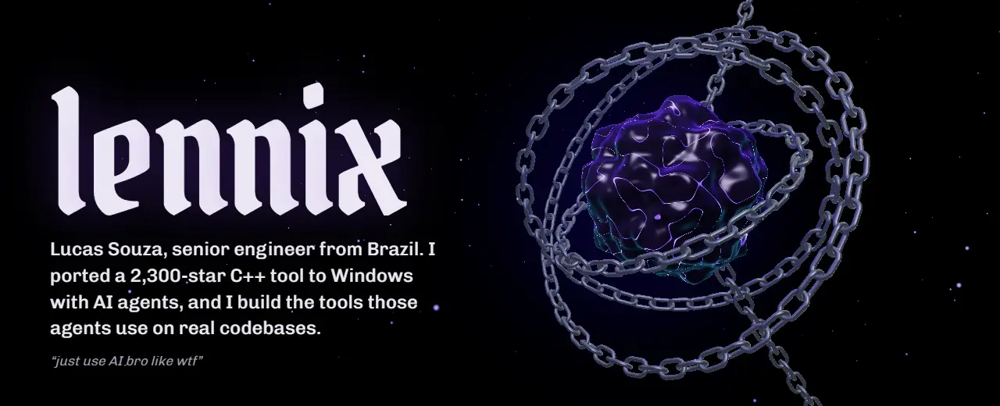
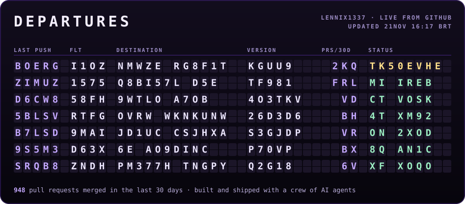

  <a href="https://lennix1337.github.io"><b>Open the 3D site</b></a> and scroll to break the chains.

Senior software developer at **Sertrading**, building B2B products and high-scale internal systems
for one of the largest trading companies in Brazil on Next.js and NestJS. Main developer at **DentAI**.
After hours I build the tools AI agents use to read, map and change real codebases.

The language is a detail. The work is the spec, the contracts, the failure modes
and the proof that the deploy did what it said.

## What's running right now

An engineering team of AI agents that I designed, run and keep tuning. It lives on an always-on server
and reports to me on Slack:

- **A lead agent with memory that never resets** ([pi-optchat](https://github.com/lennix1337/pi-optchat)). It keeps every decision from months of work, plans the next step, reviews the diffs and ships them through CI.
- **A crew of workers on Claude, Codex and Gemini**, each in its own git worktree, routed by the job and by the quota each account has left ([pi-subagents](https://github.com/lennix1337/pi-subagents), [pi-multi-account](https://github.com/lennix1337/pi-multi-account)).
- **CI that wakes the agent up** ([pi-gitwatch](https://github.com/lennix1337/pi-gitwatch)): a red check, a merge conflict or a green build triggers the next move, with no polling.
- **Guardrails that hold:** a failing test before the fix, secrets the model never sees ([pi-vault](https://github.com/lennix1337/pi-vault)), and production deploys or anything that spends money still wait for my yes.
- **It measures itself:** memory, latency, tokens and quota per delivery are tracked, and every day ends with a retro that ships fixes for what went wrong.

The board is live data from those repos, refreshed every six hours by a GitHub Action.

## What I'm working on

The six projects currently pinned on my profile: code intelligence, GeneXus tooling,
persistent agent memory, account orchestration, and a voxel sandbox.

| Project | What it is | Role |
| --- | --- | --- |
| **[ripwire](https://github.com/redhat-et/ripwire)**    | The ripgrep of AI context: a zero-dependency C++23 CLI and MCP server that hands coding agents a map of the repo before they read it. I wrote its [native Windows port](https://github.com/redhat-et/ripwire/pull/44): 8,900 lines across 175 files on Clang and the MSVC ABI, built end to end with AI agents. [Case study](https://lennix1337.github.io/ripwire-windows-port.html) | Windows port |
| **[Genexus18MCP](https://github.com/lennix1337/Genexus18MCP)**       | MCP server for working inside GeneXus knowledge bases: native SDK support for 16–18 and basic legacy compatibility back to 8. Also exploring an independent Rust engine for a bounded portable subset—not full SDK parity. `npx genexus-mcp@latest init` | Author |
| **[pi-optchat](https://github.com/lennix1337/pi-optchat)** | My extended Pi memory fork: one endless chat per profile, supervised agents, shell controls, context budgeting, recovery journals and compactor diagnostics. TypeScript, running inside ordinary Pi. | Fork maintainer |
| **[pi-multi-account](https://github.com/lennix1337/pi-multi-account)** | My Pi account-management fork: automatic failover and rotation across Anthropic, OpenAI/ChatGPT Codex, and Qwen/Alibaba, with quota-aware account selection and usage visibility. | Fork maintainer |
| **[OptMem](https://github.com/lennix1337/OptMem)** | Permanent memory for AI agents, ported to a single Rust binary. Summary trees, search, pins, amendments, stdin notes, and fixed-width storage compatible with the original format. No Python runtime or shell shim required. | Rust port / fork maintainer |
| **[bend2craft](https://github.com/lennix1337/bend2craft)** | A Minecraft-inspired voxel sandbox with Bend 2 world rules, a WebGL browser client, and a native CPU-rendered client. Terrain, physics, inventory and crafting share the same domain logic. | Author |

## The road so far

- **Now:** Sertrading, senior software developer. B2B and high-scale internal products on Next.js and NestJS.
- **2025:** DentAI, main developer. Sole engineer on a platform past 4,000 users: generative media on Gemini and Veo 3, clinical RAG, and a Next.js 15 migration that cut load times from 15s to under 4s.
- **2022:** UNIVALI, senior software engineer. Lead architect of the Universidade Gratuita program (20,000+ users); automated intake for 3,000+ candidates, saving 100+ hours of manual work.
- **2020:** Brisbane, Australia. Diploma of Software Development and Advanced Diploma of IT at Canterbury Technical Institute; came back fluent in English.

Usually in TypeScript, Next.js, NestJS, React, Node.js, C#, PostgreSQL, Docker, AWS and GitHub Actions,
with Claude, Codex and Gemini doing the typing.

  <b>Summon me:</b>
  <a href="mailto:swlucas05@gmail.com">email</a> ·
  <a href="https://www.linkedin.com/in/lucaszsouza/">LinkedIn</a> ·
  <a href="https://lennix1337.github.io">lennix1337.github.io</a>

