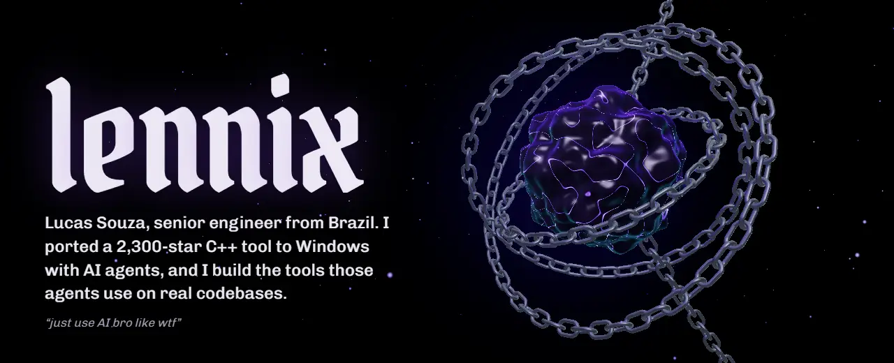

  <a href="https://lennix1337.github.io"><b>Open the 3D site</b></a> and scroll to break the chains.

Senior software developer at **Sertrading**, building B2B products and high-scale internal systems
for one of the largest trading companies in Brazil on Next.js and NestJS. Main developer at **DentAI**.
After hours I build the tools AI agents use to read, map and change real codebases.

The language is a detail. The work is the spec, the contracts, the failure modes
and the proof that the deploy did what it said.

## Selected work

| Project | What it is | Role |
| --- | --- | --- |
| **[ripwire](https://github.com/redhat-et/ripwire)**    | The ripgrep of AI context: a zero-dependency C++23 CLI and MCP server that hands coding agents a map of the repo before they read it. I wrote its [native Windows port](https://github.com/redhat-et/ripwire/pull/44): 8,900 lines across 175 files on Clang and the MSVC ABI, built end to end with AI agents. | Windows port |
| **[Genexus18MCP](https://github.com/lennix1337/Genexus18MCP)**    | MCP server that lets Claude, Cursor and Codex work inside GeneXus knowledge bases. Native SDK on 16 to 18, legacy support back to 8. `npx genexus-mcp@latest init` | Author |
| **[bend2craft](https://github.com/lennix1337/bend2craft)** | A Minecraft-style voxel sandbox where Bend 2 owns the whole world: terrain, physics, villagers, crafting. The browser only draws it. | Author |
| **[locoChat](https://github.com/lennix1337/locoChat)** | Security research on the live chat of Loco, a streaming platform. Its API took the sender's display name from the client instead of the session, so any signed-in account could post as anyone, moderators included. locoChat is the proof of concept. | Security research |

## The road so far

- **Now:** Sertrading, senior software developer. B2B and high-scale internal products on Next.js and NestJS.
- **2025:** DentAI, main developer. Sole engineer on a platform past 4,000 users: generative media on Gemini and Veo 3, clinical RAG, and a Next.js 15 migration that cut load times from 15s to under 4s.
- **2022:** UNIVALI, senior software engineer. Lead architect of the Universidade Gratuita program (20,000+ users); automated intake for 3,000+ candidates, saving 100+ hours of manual work.
- **2020:** Brisbane, Australia. Diploma of Software Development and Advanced Diploma of IT at Canterbury Technical Institute; came back fluent in English.

Usually in TypeScript, Next.js, NestJS, React, Node.js, C#, PostgreSQL, Docker, AWS and GitHub Actions,
with Claude, Codex and Gemini doing the typing.

  <b>Summon me:</b>
  <a href="mailto:swlucas05@gmail.com">email</a> ·
  <a href="https://www.linkedin.com/in/lucaszsouza/">LinkedIn</a> ·
  <a href="https://lennix1337.github.io">lennix1337.github.io</a>

